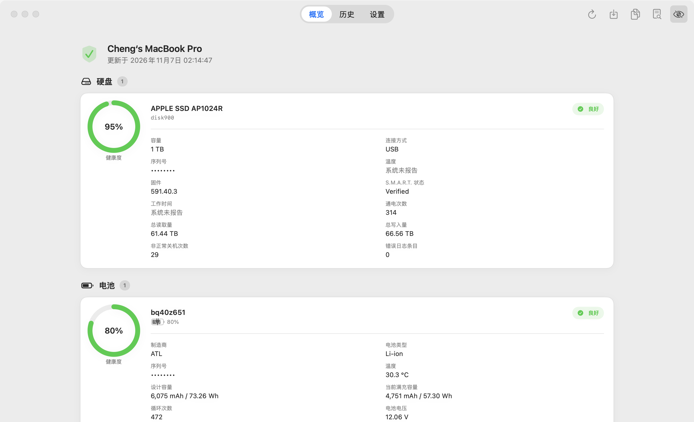
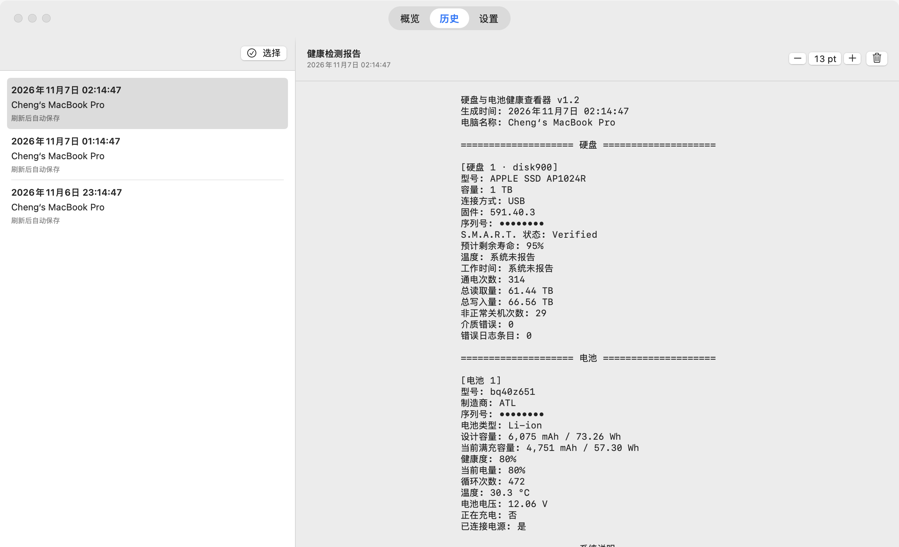
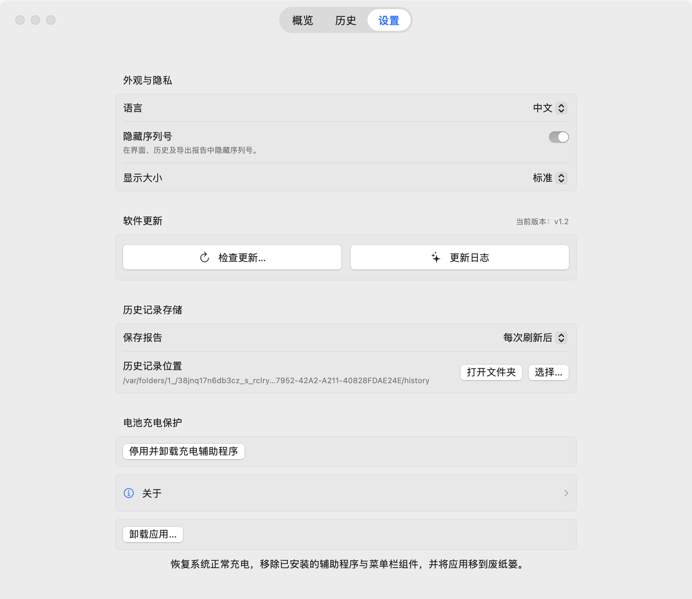
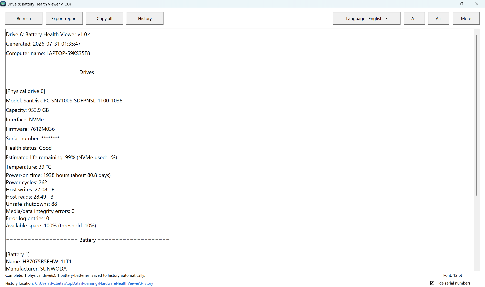
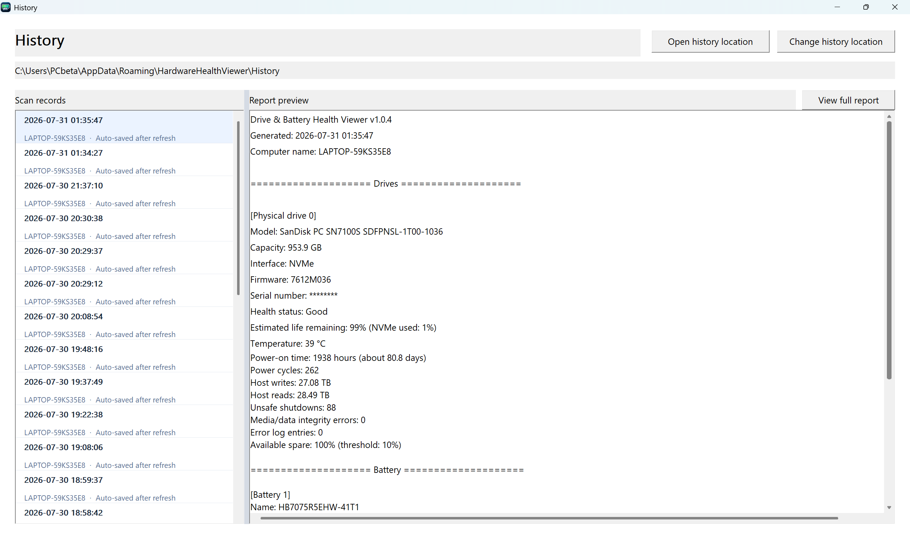

# 硬盘与电池健康查看器

**Drive & Battery Health Viewer**

简体中文 | [English](README_EN.md)

查看硬盘状态与电池健康，管理充电保护和历史报告。macOS 版采用原生 SwiftUI，Windows 版使用 Go，支持七种界面语言。

## 下载

macOS：**1.3** · Windows：**1.0.6**

| 平台 | 下载 | 系统要求 |
| --- | --- | --- |
| macOS | [下载 DMG](https://github.com/xincheng1237/drive-battery-health-viewer/releases/download/v1.3/DriveBatteryHealthViewer_v1.3-build53_macOS_Universal.dmg) | macOS 13 或更高版本，Apple 芯片与 Intel Mac |
| Windows | [下载安装程序](https://github.com/xincheng1237/drive-battery-health-viewer/releases/download/v1.0.6/DriveBatteryHealthViewer_v1.0.6_Windows_x64_Setup.exe) | Windows 7 或更高版本，x64 |

[查看 macOS 1.3 更新内容](https://github.com/xincheng1237/drive-battery-health-viewer/releases/tag/v1.3) · [全部发行版](https://github.com/xincheng1237/drive-battery-health-viewer/releases)

### 安装与更新

- **macOS**：打开 DMG，将应用拖入“应用程序”后启动。首次打开如需系统确认，可在“系统设置 → 隐私与安全性”中选择打开。
- **升级旧版 macOS 应用**：退出旧版后安装 1.3。此后可在“设置 → 检查更新”中查看新版内容、下载并安装重启。
- **Windows**：运行安装程序，按照向导完成安装。安装包提供兼容界面与现代界面；构建说明见 [BUILDING_WINDOWS.md](BUILDING_WINDOWS.md)。

## macOS 1.3

- **新增** 自动检查更新，在概览中显示可用版本，可在设置中关闭。
- **提升** 减少重复的充电状态采样、组件检查和界面刷新。
- **优化** 概览、历史和设置的浮岛导航适应更窄的窗口，方便分屏使用。
- **修复** 充电保护设置变更、系统校准或临时满充时的状态显示；改进重新接电后恢复 80% 限充的流程。

## 界面预览

### macOS



<details>
<summary>历史与设置</summary>





</details>

### Windows





## 主要功能

- 查看硬盘型号、容量、连接方式、固件、S.M.A.R.T. 状态、温度及读写统计。
- 查看电池健康度、设计与满充容量、循环次数、电量、温度及充电状态。
- 保存历史检测报告，支持多选、全选、批量导出和删除。
- 复制或导出 UTF-8 报告；实时更新电量、供电状态及温度。
- 隐藏界面、历史及导出报告中的序列号；macOS 默认开启。
- 支持简体中文、英语、俄语、法语、德语、韩语和日语。

## macOS 充电保护

主程序为 Universal 2。充电保护 Helper 和菜单栏 Agent 适用于 Apple 芯片 Mac。Intel Mac 支持健康信息、历史与报告，电池充电由 macOS 管理。

| 设备与系统 | 可用方式 |
| --- | --- |
| Apple 芯片 Mac，macOS 13 至 26.3（macOS 15.8 除外） | 80% / 85% / 90% / 95% / 100% 充电上限 |
| Apple 芯片 Mac，macOS 15.8 | Apple 原生 80% 上限；选择 100% 恢复正常充电 |
| Apple 芯片 Mac，macOS 26.4 及以上 | 系统充电上限或由本软件管理 |
| Intel Mac | 电池信息查看，充电由 macOS 管理 |

首次启用充电保护时，通过管理员授权安装充电辅助程序。菜单栏提供状态与快捷操作，“本次充满”完成后恢复原上限。系统临时满充或校准时，显示对应说明。

更多功能与开发信息见 [macOS 说明](macos/README.md)。Windows 安装包归档见 [版本归档](release-archive/README.md)。


## 从源码构建

### Windows

环境要求：Go 1.20.14。仅构建兼容界面可使用：

```bash
go test ./...
go build -o DriveBatteryHealthViewer.exe .
```

需要生成完整的双界面安装包时运行项目内的 `build-windows.ps1`；成功后会自动把
安装包写入 `release-archive`，不会覆盖已有哈希目录。具体参数见
[`BUILDING_WINDOWS.md`](BUILDING_WINDOWS.md)。

### macOS

环境要求：macOS 13 或更高版本、Swift 5.10 或更高版本。

```bash
cd macos
swift test --disable-sandbox
./scripts/build-universal.sh
./scripts/build-dmg.sh
```

## 开源许可证

本项目依据 [GNU General Public License v3.0](LICENSE) 开源发布。你可以自由使用、研究、修改和分发本项目；发布修改版本时请遵守 GPL v3.0 并保留原有版权与许可证声明。

macOS 充电控制核心参考并重构了 TY-teo 的 [ChargeWatch](https://github.com/TY-teo/ChargeWatching) 中 AppleSMC、CHTE/CHIE 与安全恢复思路，并兼容旧式 CH0B/CH0C 控制键。原项目采用 MIT License，其版权、许可证和来源说明保存在 [`macos/Resources/ThirdParty/ChargeWatch/`](macos/Resources/ThirdParty/ChargeWatch/)。

## 作者

**程心**

- GitHub：[@xincheng1237](https://github.com/xincheng1237)
- 酷安：程心ChengXin
- QQ 交流群：1040456137
- 联系邮箱：2680149724@qq.com

## 版权

© 2026 程心
