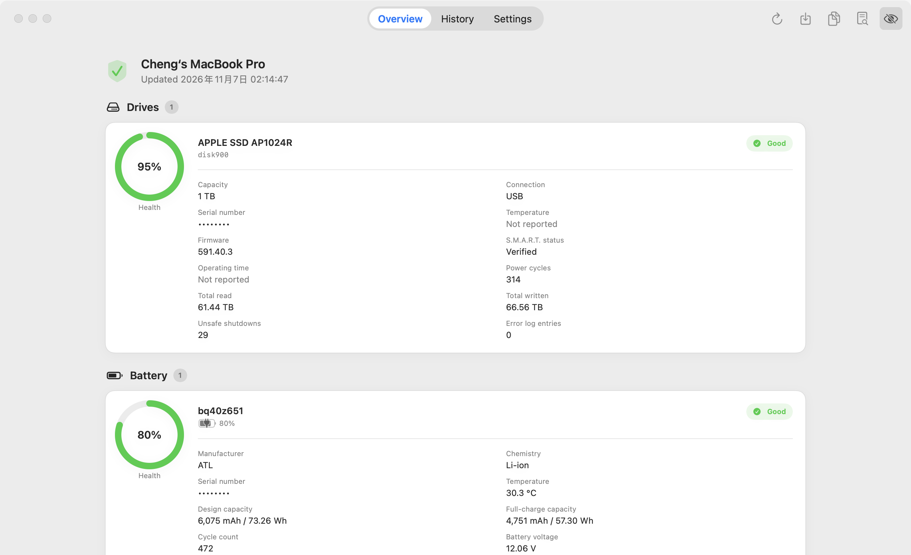
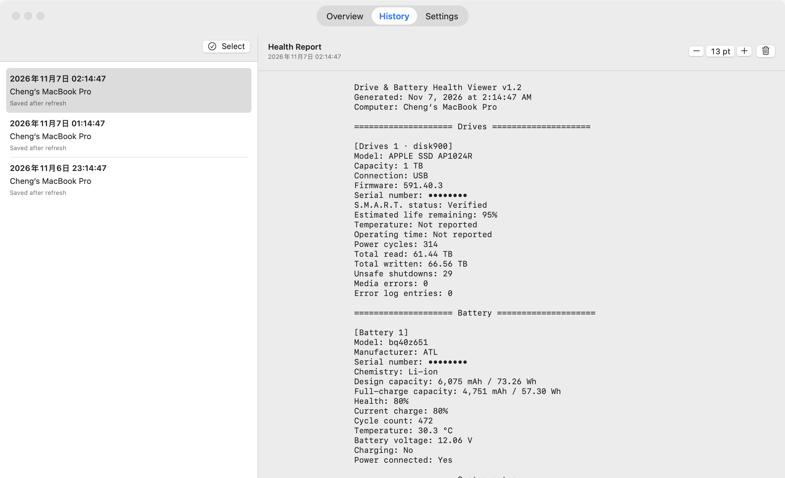
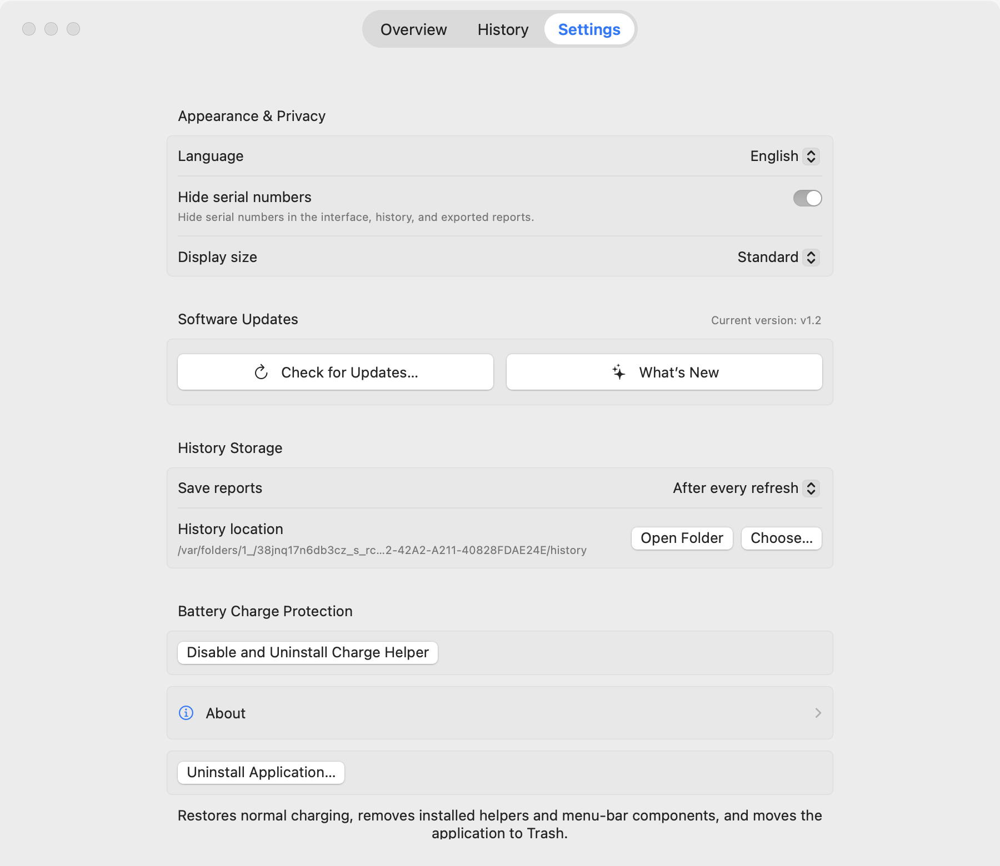
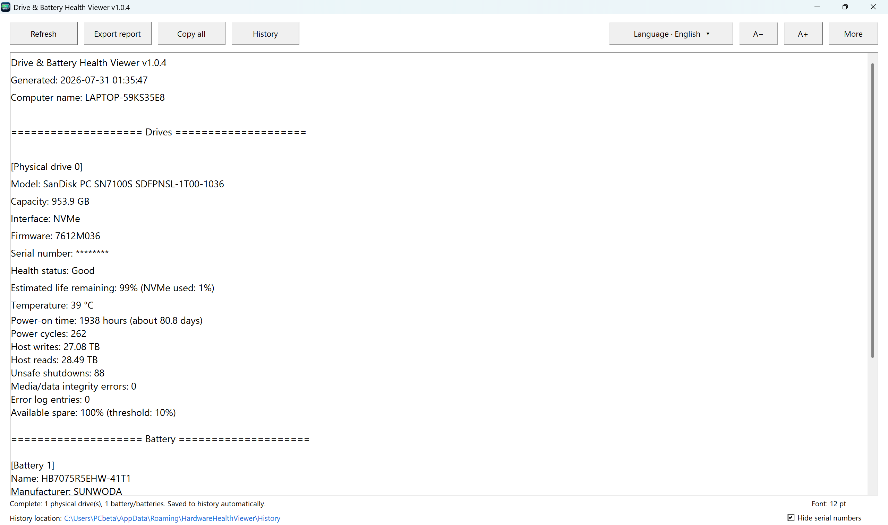
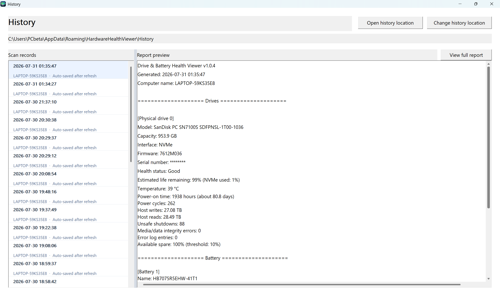

# Drive & Battery Health Viewer

**硬盘与电池健康查看器**

[简体中文](README.md) | English

View drive and battery health, manage charge protection, and browse saved reports. The macOS edition uses native SwiftUI; the Windows edition is written in Go. Seven interface languages are available.

## Download

macOS: **1.2** · Windows: **1.0.6**

| Platform | Download | Requirements |
| --- | --- | --- |
| macOS | [Download DMG](https://github.com/xincheng1237/drive-battery-health-viewer/releases/download/v1.2/DriveBatteryHealthViewer_v1.2_macOS_Universal.dmg) | macOS 13 or later, Apple silicon and Intel Macs |
| Windows | [Download installer](https://github.com/xincheng1237/drive-battery-health-viewer/releases/download/v1.0.6/DriveBatteryHealthViewer_v1.0.6_Windows_x64_Setup.exe) | Windows 7 or later, x64 |

[macOS 1.2 release notes](https://github.com/xincheng1237/drive-battery-health-viewer/releases/tag/v1.2) · [All releases](https://github.com/xincheng1237/drive-battery-health-viewer/releases)

### Installation and updates

- **macOS:** Open the DMG, drag the app into Applications, and launch it. For first-launch approval, choose Open in System Settings → Privacy & Security.
- **Upgrading an older macOS app:** Quit the old app and install 1.2. Future updates are available in Settings → Check for Updates, with release notes, download, installation, and relaunch.
- **Windows:** Run the installer and follow the setup wizard. Both compatibility and modern interfaces are included. See [BUILDING_WINDOWS.md](BUILDING_WINDOWS.md) for build information.

## macOS 1.2

- **A new interface:** A compact navigation capsule connects Overview, History, and Settings, with report actions in the toolbar.
- **Four display sizes:** Small, Standard, Large, and Extra Large adjust interface text and information layout together.
- **History reading:** Smooth report transitions and independent text sizing with − / ＋ controls.
- **Settings and app information:** Release notes, update checks, and About are accessible from Settings.
- **In-app updates:** Read what's new, download the update, then confirm installation and relaunch.
- **Charging status:** Separate active limiting, temporary full charging, and calibration states while retaining the saved limit.

## Screenshots

### macOS



<details>
<summary>History and Settings</summary>





</details>

### Windows





## Features

- View drive model, capacity, connection, firmware, S.M.A.R.T. status, temperature, and read/write statistics.
- View battery health, design and full-charge capacity, cycle count, charge level, temperature, and charging state.
- Save reports with multi-select, Select All, batch export, and deletion.
- Copy or export UTF-8 reports, with live charge, power-state, and temperature updates.
- Hide serial numbers in the interface, history, and exported reports; enabled by default on macOS.
- Use Simplified Chinese, English, Russian, French, German, Korean, or Japanese.

## macOS charge protection

| Device and system | Available control |
| --- | --- |
| Apple silicon, macOS 13–26.3 except macOS 15.8 | 80% / 85% / 90% / 95% / 100% limits |
| Apple silicon, macOS 15.8 | Apple's native 80% limit; select 100% for normal charging |
| Apple silicon, macOS 26.4 or later | System charging limits or app-managed charging |
| Intel Macs | Battery information; charging is managed by macOS |

The first activation installs the charging helper with administrator approval. Menu-bar status and quick actions remain available, and Charge to Full Once restores the saved limit afterward. System full-charge and calibration states have their own explanations.

See the [macOS guide](macos/README.md) for details and development information, and the [Windows release archive](release-archive/README.md) for archived installers.


## Building from Source

### Windows

Go 1.20.14 is required for the release build (the script checks the exact version).
For a compatibility-only build, use:

```bash
go test ./...
go build -o DriveBatteryHealthViewer.exe .
```

To produce the complete dual-interface installer, run `build-windows.ps1`. A successful
installer build is automatically copied into `release-archive` without replacing an
existing hash directory. See [`BUILDING_WINDOWS.md`](BUILDING_WINDOWS.md) for options.

### macOS

Requires macOS 13 or later and Swift 5.10 or later.

```bash
cd macos
swift test --disable-sandbox
./scripts/build-universal.sh
./scripts/build-dmg.sh
```

## License

This project is released under the [GNU General Public License v3.0](LICENSE). You may use, study, modify, and distribute it. Modified distributions must comply with GPL v3.0 and retain the original copyright and license notices.

The macOS charge-control core adapts and refactors the AppleSMC, CHTE/CHIE, and fail-safe concepts from TY-teo’s [ChargeWatch](https://github.com/TY-teo/ChargeWatching), with compatibility for the legacy CH0B/CH0C control pair. ChargeWatch is MIT-licensed; its copyright, license, and source notice are retained in [`macos/Resources/ThirdParty/ChargeWatch/`](macos/Resources/ThirdParty/ChargeWatch/).

## Author

**ChengXin**

- GitHub: [@xincheng1237](https://github.com/xincheng1237)
- Coolapk: 程心ChengXin
- QQ group: 1040456137
- Email: 2680149724@qq.com

## Copyright

© 2026 ChengXin
